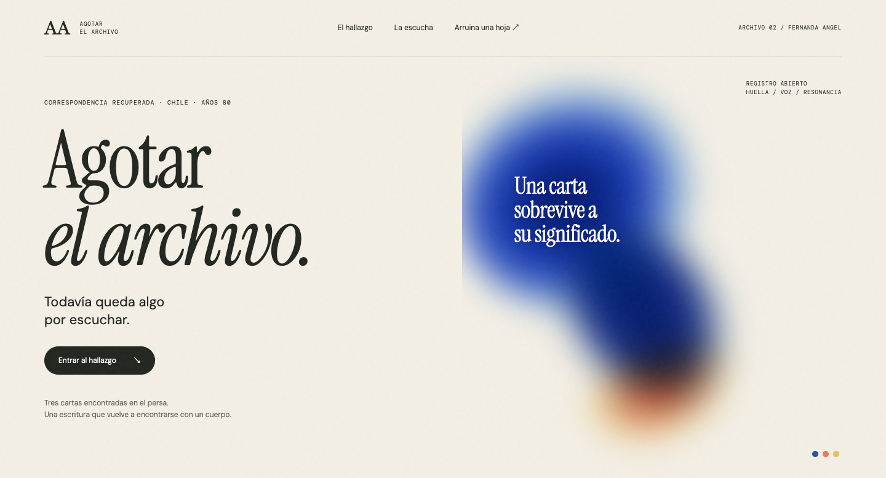
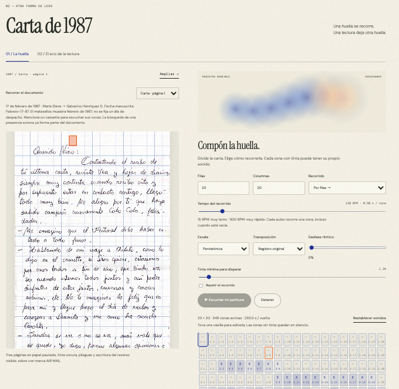
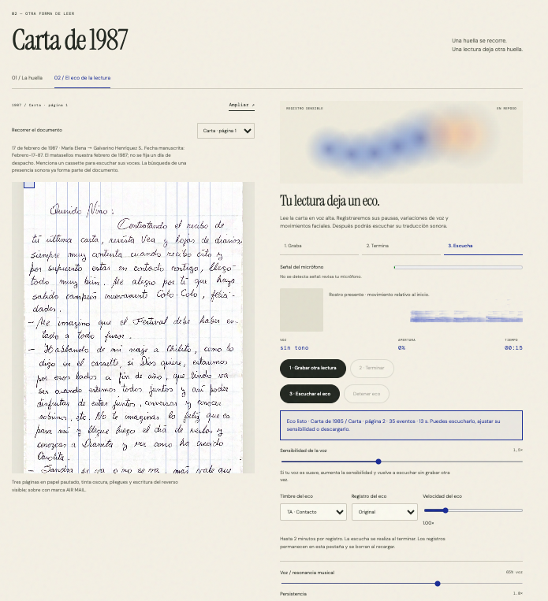

# Agotar el archivo

**Fernanda Angel · Universidad Diego Portales · DPPI 2026 · T06 Sonidos**  
Proyecto individual de exploración de la relación entre sonido e imagen.

> Una carta sobrevive a su significado.

**[Entrar a la plataforma](https://fernandaangel-cpu.github.io/agotar-el-archivo/)** · **[Repositorio](https://github.com/fernandaangel-cpu/agotar-el-archivo)**

## 1. Concepto y relación imagen–sonido

*Agotar el archivo* nace de tres cartas recuperadas del persa en Chile, fechadas en **1985, 1986 y 1987**. Los sobres sitúan su recorrido desde Wilmington, California, hacia Santiago. Son envíos dirigidos a una misma persona que permiten acercarse a una correspondencia a través del tiempo. La plataforma reúne sus páginas y sobres para visitar el hallazgo, detenerse en sus marcas y ensayar otras maneras de leerlo.

Me interesa aquello que la palabra escrita no alcanza a resolver: la distancia, las pausas, la materialidad y el contexto que imaginamos al leer. La propuesta consiste en una **traducción diseñada entre imagen, cuerpo y sonido**. Cada composición depende de una regla de lectura que se puede modificar.

La experiencia tiene dos recorridos:

- **La huella:** la imagen de la carta se convierte en una partitura espacial. La presencia y distribución de tinta disparan sonidos al recorrer una grilla de filas y columnas.
- **El eco de la lectura:** una persona lee en voz alta. Las variaciones de intensidad, altura vocal, pausas y movimiento facial se traducen después en una composición diferente de la voz original.

La carta de 1987 menciona un cassette para escuchar sus voces. Este detalle vuelve especialmente significativa la relación entre escritura, distancia y sonido: la búsqueda de una presencia audible ya formaba parte de esa correspondencia. La plataforma no reconstruye ese cassette ni las voces históricas; añade una nueva mediación al encuentro con las cartas.

El proyecto continúa una pregunta de mi trabajo anterior, *Confiésate aquí*: ¿qué sucede cuando una medición física se transforma en una representación sensible? Aquí el documento deja una huella, el cuerpo que lo lee produce otra y el sistema compone a partir de ambas. **Intentar agotar el archivo produce más archivo.**

La invitación **«Arriésgate: arruina una hoja blanca»** toma posición frente a la comunicación inmediata y la facilidad de borrar. Recupera el tiempo de escribir, tachar y volver sobre una palabra. La plataforma también permite cargar una imagen propia y explorar sus marcas.

## 2. Banco de sonidos y disparador

### Un lenguaje sin palabras

El banco reúne **10 sonidos originales de síntesis**, creados mediante código con asistencia de IA para este proyecto. Combina aproximaciones a vocales, un murmullo, aire, fricción y articulaciones breves. Las vocales se construyen con armónicos y resonancias; el aire y la fricción, con ruido filtrado. No son grabaciones de personas ni fragmentos de canciones.

La elección busca una materia cercana al habla que no pronuncie el contenido de la carta. La mezcla con una resonancia musical permite aproximar la escucha a una voz deformada o a una composición de notas. Los sonidos no representan emociones universales ni permiten deducir lo que sentía quien escribió.

Los archivos son WAV mono, 44,1 kHz, 16 bits.

| Archivo | Nombre | Duración | Autoría y origen | Licencia |
| --- | --- | --- | --- | --- |
| `audio/a.wav` | Apertura · A | 2,2 s | Síntesis procedimental original para el proyecto, generada con asistencia de IA | CC0 1.0 |
| `audio/e.wav` | Claridad · E | 2,1 s | Mismo origen | CC0 1.0 |
| `audio/i.wav` | Hilo · I | 2,0 s | Mismo origen | CC0 1.0 |
| `audio/o.wav` | Cavidad · O | 2,4 s | Mismo origen | CC0 1.0 |
| `audio/u.wav` | Profundidad · U | 2,6 s | Mismo origen | CC0 1.0 |
| `audio/m.wav` | Murmullo · M | 2,5 s | Mismo origen | CC0 1.0 |
| `audio/s.wav` | Fricción · S | 0,65 s | Mismo origen | CC0 1.0 |
| `audio/f.wav` | Aire · F | 1,2 s | Mismo origen | CC0 1.0 |
| `audio/ta.wav` | Contacto · TA | 0,32 s | Mismo origen | CC0 1.0 |
| `audio/ka.wav` | Quiebre · KA | 0,4 s | Mismo origen | CC0 1.0 |

La licencia [CC0 1.0](https://creativecommons.org/publicdomain/zero/1.0/) corresponde al banco sonoro original. No se extiende a las cartas históricas ni a las bibliotecas y tipografías externas. Las digitalizaciones proceden de las cartas recuperadas para el proyecto; no se les atribuye una licencia de uso libre.

### Disparador visual: la huella

La imagen se analiza mediante luminosidad para separar marcas oscuras y fondo. Se divide en una grilla configurable y se recorre en el tiempo. **Cada pulso visita una casilla**; si tiene suficiente tinta y no está silenciada, dispara su sonido. Las casillas vacías conservan su tiempo como pausa.

| Dato o decisión | Traducción sonora |
| --- | --- |
| Presencia de tinta por encima del mínimo seleccionado | Activa el sonido de la casilla |
| Densidad de tinta | Modifica la intensidad |
| Densidad y complejidad local de los bordes | Proponen automáticamente un timbre del banco |
| Fila de la grilla | Propone una nota en la escala elegida |
| Posición horizontal | Modifica el panorama estéreo |
| Sonido, nota y silencio elegidos por la persona | Sustituyen la propuesta automática de esa casilla |
| Tempo, orden y desfase | Definen cuándo se visita cada zona |

La lectura se puede organizar por filas o columnas y en ambos sentidos. El cursor naranja relaciona la zona visitada con la composición. No se utiliza reconocimiento de texto: el sistema no entiende palabras ni identifica con certeza un borrón, un error o la presión del bolígrafo. Una ilustración, un pliegue o una sombra pueden intervenir en el resultado si se interpretan como marca.

### Registro corporal y vocal: el eco

Al activar cámara y micrófono, se realizan **1,5 segundos de calibración en silencio**. Después se lee en voz alta y se cierra el registro con «Terminar». El sistema conserva características numéricas durante la sesión, no una grabación de la voz ni un video.

| Característica registrada | Traducción sonora |
| --- | --- |
| Intensidad sobre el nivel de fondo | Activa eventos y modifica su volumen |
| Altura vocal estimada, cuando hay periodicidad fiable | Selecciona una nota aproximada |
| Señal sin altura vocal fiable | Produce aire |
| Pausas internas | No añaden eventos; dejan decaer los anteriores |
| Apertura de boca relativa al inicio | Cambia entre vocales y modifica la duración |
| Variaciones de cejas y comisuras | Pueden añadir una articulación TA |
| Inclinación de la línea de ojos | Modifica el panorama estéreo |

El espectrograma muestra variaciones de energía por frecuencia a lo largo del tiempo. MediaPipe Face Landmarker aporta medidas del movimiento facial. **Estas medidas no se interpretan como diagnósticos de emociones.** Si el rostro o el modelo no están disponibles, el micrófono permite continuar la lectura sonora.

La última lectura se conserva al cambiar de carta o de página. Se puede ajustar su sensibilidad, velocidad, timbre y registro sin volver a grabar. Se pierde al iniciar otro registro o recargar la página.

## 3. Parámetros y gráfica

### Decidir cómo escuchar

La personalización permite discutir la traducción y componer con ella. Los controles hacen visible que una misma carta admite distintas duraciones y organizaciones sonoras.

| Parámetro | Rango o posibilidades | Relación con el concepto |
| --- | --- | --- |
| Filas y columnas | 1–24 de cada una | Cambia la escala de observación: agrupa marcas o las fragmenta |
| Tempo | 15–900 BPM | Desde 4 s hasta aproximadamente 67 ms por casilla; cambia el tiempo dedicado a la huella |
| Orden | Filas, columnas y reversa | Permite recorrer el documento de otras maneras |
| Sonido por zona | 10 timbres | Hace explícita la elección de qué materia sonora representa cada marca |
| Nota por zona | Do 3–Do 5 | Permite intervenir la melodía propuesta |
| Escala | Pentatónica, menor o cromática | Cambia las relaciones entre las alturas automáticas |
| Transposición | Hasta dos octavas hacia arriba o abajo | Desplaza el registro de la composición |
| Desfase rítmico | 0–80 % | Desplaza pulsos alternos y altera la regularidad del recorrido |
| Silencio por zona | Activar o silenciar | Permite elegir qué marcas escuchar y cuáles dejar fuera |
| Umbral y tinta mínima | Ajustables | Expone la decisión de qué cuenta como marca suficiente |
| Repetición | Activada o desactivada | Permite regresar al documento y escuchar sus recurrencias |
| Mezcla voz / resonancia musical | 0–100 % de timbre vocal | Acerca el sonido al lenguaje o a la nota sostenida |
| Persistencia | 0,1–4× | Modifica cuánto dura la huella sonora, dentro de la duración disponible de cada muestra |
| Volumen | 0–100 % | Adapta la intensidad de la escucha |
| Sensibilidad del eco | 0,5–3× | Ajusta qué variaciones de la voz superan el filtro de entrada |
| Velocidad del eco | 0,25–4× | Dilata o comprime temporalmente la lectura registrada |
| Timbre y registro del eco | Automático o elegido; ±2 octavas | Permite reinterpretar el mismo registro sin grabarlo otra vez |

### Decisiones gráficas

El fondo marfil y el grano remiten a la superficie del papel. El azul cobalto construye una presencia difusa, con acentos coral y amarillo. Las manchas cambian durante la actividad sonora y conviven con la precisión de la grilla y las mediciones.

**Instrument Serif** aporta una voz editorial a los títulos; **DM Sans** organiza la lectura de la interfaz y **DM Mono** identifica fechas, zonas y datos. La composición mantiene la carta visible junto a los controles para relacionar cada decisión con el documento. El azul no codifica una emoción detectada: es una decisión gráfica del proyecto.

La portada presenta el hallazgo, la colección permite elegir un envío y la mesa reúne las dos lecturas. Más abajo, la invitación a traer un archivo propio abre la experiencia a otras correspondencias.

*Portada: «Una carta sobrevive a su significado».*

*La huella: recorrido de una carta mediante una grilla personalizable. En esta captura se utiliza una configuración de 23 × 20 zonas.*

*El eco: un registro listo para escuchar, con 35 eventos y 13 segundos de composición. La captura muestra una lectura conservada de la carta de 1985 mientras se consulta la de 1987.*

### Cómo usar la plataforma

1. Abre la [página pública](https://fernandaangel-cpu.github.io/agotar-el-archivo/). No requiere cuenta de ChatGPT.
2. Elige una de las tres cartas y una página o cara del sobre.
3. En **La huella**, define la grilla y el tempo. Pulsa «Escuchar mi partitura». Toca una casilla para cambiar su sonido, nota o silencio.
4. En **El eco de la lectura**, pulsa «Grabar mi lectura» y permite cámara y micrófono. Espera la calibración, lee y pulsa «Terminar». Después selecciona «Escuchar el eco».
5. Modifica los parámetros y descarga la composición WAV si quieres conservarla.
6. Para otro documento, utiliza «Traer mi archivo». Las imágenes propias se procesan localmente y no se agregan a la colección pública.

El sitio funciona con HTML, CSS y JavaScript, Canvas 2D, Web Audio API y MediaPipe Tasks Vision. Está publicado mediante GitHub Pages. Cámara y micrófono requieren HTTPS o localhost y los permisos correspondientes. Las fuentes y el modelo facial se cargan desde servicios externos; las imágenes propias y los datos de lectura se procesan en el navegador.

Los registros tienen un máximo de dos minutos. La exportación WAV se limita a composiciones de hasta diez minutos para controlar el uso de memoria. Las configuraciones muy lentas y densas pueden superar ese límite, aunque se puedan reproducir.

La propuesta se desarrolló con asistencia de IA en programación y síntesis sonora. [Oír la luz](https://github.com/fefeliperoar/oir-la-luz) es la referencia de la herramienta base del encargo; esta implementación utiliza código propio para sus recorridos y controles.

## 4. Reflexión

Traducir una carta en sonido obliga a decidir qué parte de ella se vuelve audible. Al cambiar la cantidad de zonas, el tempo o el orden, una misma superficie puede organizarse de maneras diferentes. La composición no se encuentra intacta dentro del papel: aparece en el encuentro entre sus marcas y una regla diseñada.

La escritura deja de ser solamente un vehículo para el significado. Los espacios, la concentración de tinta y los elementos gráficos pueden ocupar un lugar en la escucha. A la vez, el sistema no distingue automáticamente qué marca fue una decisión del remitente y cuál apareció por el paso del tiempo o la digitalización. Esa limitación importa: una sombra puede convertirse en un sonido con la misma legitimidad técnica que una letra.

En el eco, quien lee añade una duración, una voz y nuevos movimientos. El funcionamiento del registro y su reproducción se comprobó durante las pruebas de uso. La posibilidad de conservar una lectura al cambiar de página permite reconocer que ese eco pertenece a un encuentro concreto con el archivo, aunque después acompañe otro documento. No constituye evidencia de cómo se sentía quien escribió.

La referencia al cassette en la carta de 1987 hace visible que el deseo de escuchar a alguien ya atravesaba esta correspondencia. Hoy puedo producir una composición a partir de sus huellas, pero sigo sin acceder a aquellas voces. La plataforma acerca ciertos aspectos del documento y mantiene otros fuera de alcance: el sentido íntimo de cada frase, las intenciones, el contexto perdido y la historia completa de sus recorridos.

**Agotar el archivo no significa resolverlo. Significa volver a él y reconocer que cada lectura deja algo nuevo.**

### Mejoras concretas

1. **Separar mejor las marcas del soporte.** Incorporar corrección de iluminación e inclinación, y una herramienta para delimitar o excluir manualmente ilustraciones, pliegues y sombras. Esto permitiría comparar una lectura de la escritura con otra de toda la superficie.
2. **Comparar varias lecturas del mismo documento.** Guardar versiones con sus parámetros y colocar sus composiciones y registros lado a lado para reconocer qué cambia entre lectores, velocidades y decisiones de traducción.
3. **Profundizar la ficha de cada carta.** Documentar las circunstancias del hallazgo y permitir anotaciones que distingan lo legible, lo supuesto y lo desconocido, sin llenar esos vacíos con datos inventados.
